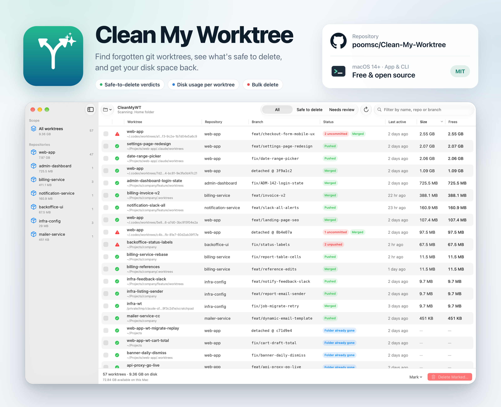

# Clean My Worktree

**Find and remove forgotten git worktrees, and get your disk space back. Runs on Windows, macOS and Linux.**


[](https://github.com/v4r1n/CrossClean-My-Worktree/releases/latest)



> CrossClean My Worktree is a cross-platform port of [poomsc/Clean-My-Worktree](https://github.com/poomsc/Clean-My-Worktree), the original macOS app, rewritten in Go so it also runs on Windows and Linux. See [docs/CHANGELOG.md](docs/CHANGELOG.md) and [docs/MIGRATING.md](docs/MIGRATING.md).

If you use `git worktree`, or AI coding agents that create a worktree for every task, they pile up quickly. Each one is a full checkout, often with its own `node_modules` or build output, and it's easy to forget them in `.worktrees/`, `.claude/worktrees/`, a temp folder or wherever the last session left them.

Clean My Worktree (CleanMyWT) scans your computer and lists every worktree in one window. You can see which repo each one belongs to, whether it still holds unsaved work, and how much space deleting it gives back. Then you delete them all at once or pick the ones you want.

## Features

- **Finds worktrees anywhere.** Scan your home folder, the entire computer (every drive on Windows) or any folder you choose. Worktrees outside that folder (such as a temp folder) still show up, because every repository found is asked for its full worktree list.
- **Shows what's at stake.** Each worktree gets a verdict based on uncommitted files, unpushed commits, whether its branch is merged, and whether a running process (terminal, editor, agent) is using it.
- **Reports real disk usage.** The **Size** column is what's on disk. The **Frees** column is what deleting gives back; files hard-linked from elsewhere, such as a pnpm store, are left out.
- **Groups by repository.** The sidebar shows each repo with its number of worktrees and total size.
- **Deletes in bulk, carefully.** Mark worktrees with checkboxes (shift-click marks a range) or mark everything that's safe in one step. A confirmation dialog lists anything risky before you delete. Local branches can optionally be deleted too, but only if they're fully merged.
- **Cleans up stale records.** It finds worktrees whose folder is already gone and worktrees whose repository was deleted.
- **Includes a command-line tool.** `wtscan` prints the same report in the terminal.

## How it runs

CleanMyWT is a single small program with no runtime to install. Start `cleanmywt` and it opens the app in your default browser, served from your own computer (`127.0.0.1`, never the network). Keep its terminal window open while you use it; close it or press Ctrl+C to quit.

## Requirements

- **Windows 10 or later, macOS 11 or later, or Linux**, on x64 or Arm.
- **git** on your `PATH`.
  - Windows: install [Git for Windows](https://git-scm.com/download/win) (`winget install Git.Git`).
  - macOS: `xcode-select --install` or `brew install git`.
  - Linux: your package manager, e.g. `sudo apt install git`.

## Install

### Download

1. Download the zip for your computer from the [latest release](https://github.com/v4r1n/CrossClean-My-Worktree/releases/latest):

   | Computer | File |
   | --- | --- |
   | Windows (most PCs) | `CleanMyWT-x.y.z-windows-amd64.zip` |
   | Windows on Arm | `CleanMyWT-x.y.z-windows-arm64.zip` |
   | Mac with Apple silicon | `CleanMyWT-x.y.z-darwin-arm64.zip` |
   | Intel Mac | `CleanMyWT-x.y.z-darwin-amd64.zip` |
   | Linux | `CleanMyWT-x.y.z-linux-amd64.zip` or `-linux-arm64.zip` |

2. Unzip it anywhere and run `cleanmywt` (`cleanmywt.exe` on Windows).

The programs aren't code-signed, so the first launch needs one extra step:

- **Windows:** if SmartScreen says "Windows protected your PC", click **More info → Run anyway**. Or, in PowerShell: `Unblock-File .\cleanmywt.exe, .\wtscan.exe`.
- **macOS:** run `xattr -d com.apple.quarantine cleanmywt wtscan` in the unzipped folder, or allow it under **System Settings → Privacy & Security → Open Anyway**.

To check the download, compare its SHA-256 with `SHA256SUMS.txt` on the release page (`Get-FileHash file.zip` on Windows, `shasum -a 256 file.zip` on macOS).

To put `wtscan` on your `PATH`: on Windows, copy it to a folder that's already on `PATH` or add the unzipped folder in **Settings → System → About → Advanced system settings → Environment Variables**; on macOS/Linux, `sudo mv wtscan /usr/local/bin/`.

### Build from source

You need [Go](https://go.dev/dl/) 1.22 or later.

```bash
git clone https://github.com/v4r1n/CrossClean-My-Worktree.git
cd CrossClean-My-Worktree
go build -o build/ ./cmd/...      # builds build/cleanmywt and build/wtscan (.exe on Windows)
```

Or install straight onto your `PATH`: `go install github.com/v4r1n/CrossClean-My-Worktree/cmd/...@latest`.

`scripts/dist.sh` cross-compiles release zips for every platform into `dist/`.

### Uninstall

Delete the two programs. To also remove saved settings (scan location and recent folders), delete the `CleanMyWT` folder in your config folder: `%AppData%\CleanMyWT` on Windows, `~/Library/Application Support/CleanMyWT` on macOS, `~/.config/CleanMyWT` on Linux.

## Usage

1. Run `cleanmywt`. It opens in your browser and scans your home folder.
2. To scan somewhere else, pick **Entire computer**, a recent folder, or **Choose folder…** from the location menu and type the path. Press **Ctrl+R** (⌘R) to rescan.
3. Review the list. Filter it with **Safe to delete** / **Needs review**, search by name, repo or branch, or click a column to sort.
4. Mark the worktrees you want to remove, then click **Delete marked…** (or press **Delete**).

`cleanmywt --no-browser` only prints the link; `--port 8123` uses a fixed port.

### What the verdicts mean

| Verdict | When | What to do |
| --- | --- | --- |
| ✔ **Safe** | No uncommitted or untracked files, and every commit is merged into the default branch or pushed to a remote. Also any worktree whose folder is already gone. | Delete freely. |
| ? **Review** | Locked, its repository can't be found (deleted, or on a drive that isn't connected), or git couldn't read it. | Look before deleting. |
| ⚠ **Risky** | Has uncommitted or untracked files, commits that exist only locally, or a process is working inside it. | Deleting loses that work or breaks a running session. |

Hover over the status badges for details such as upstream, ahead/behind counts and file counts.

### Marking shortcuts

- **Click** a checkbox to mark one worktree.
- **Shift-click** a second checkbox to mark or unmark every row between the two.
- **Mark safe to delete** marks every safe worktree currently shown.
- **Right-click** a row (or use its **⋯** button) to show it in Explorer/Finder, open a terminal there or copy its path.

### "Folder already gone"

Git keeps a record of each worktree in `<repo>/.git/worktrees/<name>`. If the folder is deleted some other way (`rm -rf`, Explorer, or the OS clearing its temp folder), that record stays behind. It takes almost no space, but the branch still counts as checked out, so `git checkout <branch>` elsewhere fails with *"already used by worktree"*. Deleting one of these only removes the stale record, which is the same as `git worktree prune` for that one entry.

## Command line

```bash
wtscan                     # scan your home folder
wtscan ~/code ~/work       # scan specific folders (C:\code works too)
wtscan --no-size           # skip disk usage (much faster)
```

```
SAFE    my-api        388.6 MB  388.6 MB  feat/new-endpoint     merged          ~/code/.worktrees/new-endpoint
RISKY   my-web        2.55 GB   2.55 GB   feat/redesign         2 uncommitted   ~/code/my-web/.claude/worktrees/redesign
...
88 worktrees · 19.84 GB on disk · 19.84 GB reclaimable · 82 safe to delete (17.08 GB)
```

## How it works

1. **Find repositories.** It walks the chosen folders and looks for `.git` entries. A `.git` *directory* with a `worktrees/` subfolder is a repository with worktrees. A `.git` *file* is a linked worktree, and its `gitdir:` line leads back to the repository even when that repository is outside the scanned folder. Symlinks and Windows junctions are never followed. Heavy folders that never contain worktrees (`node_modules`, package-manager caches, build output, system folders) are skipped.
2. **List worktrees.** It runs `git worktree list --porcelain` for each repository. The main checkout is never listed.
3. **Check status.** For each worktree it runs `git status --porcelain=v2 --branch`, counts commits that are on no remote (`git rev-list HEAD --not --remotes`), and checks whether HEAD is merged into the default branch (`origin/HEAD`, falling back to `main`, `master` or `develop`). It then finds processes whose working directory is inside a worktree: from the process environment block on Windows, `/proc` on Linux and `lsof` on macOS.
4. **Measure.** It adds up the allocated size of every file. A hard-linked file counts only once, and counts as reclaimable only when all of its links are inside the worktree.

### Safety

- **Scanning is read-only.** Git runs with `GIT_OPTIONAL_LOCKS=0`, so a scan never takes `index.lock` in a worktree that another tool is using.
- **Deleting uses `git worktree remove --force`.** If git refuses (for example, because the worktree contains submodules), the app removes the folder and its record directly instead. Read-only files are handled on Windows, and links inside the worktree (such as pnpm's junctions) are removed without touching what they point to.
- **Main checkouts can't be deleted.** A folder is deleted only if it has a `.git` *file*, which marks a linked worktree, and only if it came from the current scan.
- **Deletion is permanent.** Folders don't go to the Recycle Bin or Trash, because the point is to free space. Commits and branches stay in the repository.
- **The local server is locked down.** It listens on `127.0.0.1` only, and every request must carry a random per-launch token from the link it prints, so other websites and other users' programs can't drive it.

## Limitations

- **Windows sizes are estimates.** Size is each file's length rounded up to the drive's cluster size; tiny files that NTFS stores inside its file table and compressed files use less than shown.
- **Copy-on-write clones** (APFS, Btrfs, ReFS block cloning) share blocks with other files, so **Frees** can overstate what you'll get back.
- **Squash merges:** "Merged" means HEAD is an ancestor of the default branch, so squash-merged branches show as not merged. They still count as safe if they were pushed.
- **"In use" sees your own processes only.** Processes run by other users or as administrator aren't checked unless you run CleanMyWT with the same rights.
- **Protected folders** your user can't read are skipped (on macOS, grant Full Disk Access to your terminal to include them).

## Project structure

```
cmd/
  cleanmywt/       the app: starts the local server and opens the browser
  wtscan/          the command-line tool
internal/
  wtkit/           scanning, git inspection, disk usage and removal (no UI)
  app/             HTTP API and state for the app
  app/web/         the browser UI (plain HTML, CSS and JavaScript, embedded in the binary)
scripts/
  dist.sh          cross-compiles release zips
docs/              CHANGELOG, MIGRATING (from the macOS app), DECISIONS (ADRs), MEMORY (project state)
CLAUDE.md          guide for AI coding assistants
.github/workflows/build.yml  tests on Windows, macOS and Linux; pushing a v* tag publishes a release
```

Run the tests with `go test ./...`. They create throwaway repositories in a temp folder and need git.

## Contributing

Issues and pull requests are welcome. Keep the core logic in `internal/wtkit`, so the app and the CLI stay in sync, and test anything that deletes files against a throwaway repository first.

## License

[MIT](LICENSE)
